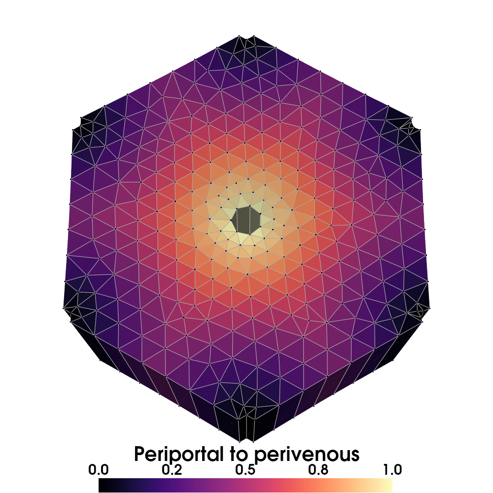

# Mesh zonation

Zonation assigns a normalized position between periportal inflow and
perivenous outflow, then evaluates patterns on that position.

{ width="600" }

The bundled liver mesh rendered using the [visualization example](visualization.md#render-a-static-mesh).

## Input mesh

The implementation supports multiple cell blocks. Provide these cell fields:

| Field | Values | Purpose |
| --- | --- | --- |
| `cell_type` | `0`: interior, `1`: periportal, `2`: perivenous | Boundary labels |
| `volume` or `element_volume_point_TPM` | Finite, nonnegative cell volumes with positive total | Pattern normalization |

Both boundary types must be represented. Geometry, boundary labels, and cell
volumes must describe the same cells. The default operation copies the mesh,
removes existing point fields, and retains boundary labels and volumes before
adding zonation fields. Set `remove_point_data=False` or `remove_cell_data=False`
only when you need to preserve existing fields. Both volume field names work
with either option; the result exposes a canonical `volume` field. Invalid
geometry, labels, or volumes are rejected before mutating an input mesh.

The computed `position` is `0` for periportal cells and `1` for perivenous cells.
Interior positions use distances to boundary cell centers. This is a geometric
distance estimate, not a transport simulation or a distance along flow paths.
Nearest boundary queries use spatial indexes across every block. Distances are
not clipped to one mesh unit, so changing length units preserves positions.

## Generate and export patterns

```python
from pathlib import Path

from porous_media import RESOURCES_DIR
from porous_media.mesh.mesh_tools import mesh_to_vtk, mesh_to_xdmf
from porous_media.mesh.mesh_zonation import ZonatedMesh, ZonationPatterns

output_dir = Path("results") / "zonation"
output_dir.mkdir(parents=True, exist_ok=True)
mesh = ZonatedMesh.create_zonated_mesh_from_vtk(
    vtk_path=RESOURCES_DIR / "zonation" / "mesh_zonation_lobulus.vtk",
    patterns=[
        ZonationPatterns.constant,
        ZonationPatterns.linear_increase,
        ZonationPatterns.linear_decrease,
    ],
)

mesh_to_vtk(mesh, output_dir / "zonated.vtk", test_read=True)
mesh_to_xdmf(mesh, output_dir / "zonated.xdmf", test_read=True)
print(sorted(mesh.cell_data))
```

`create_zonated_mesh_from_vtk` returns a mesh. Export it explicitly using the
mesh helpers or meshio. Generated field names start with `pattern__`, such as
`pattern__linear_increase`.

Patterns are sampled once and scaled to match the volume-weighted mean of the
constant reference pattern, whose default value is `0.5`. Values are not guaranteed
to remain between `0` and `1` after normalization. `position` remains the spatial
coordinate; pattern values represent the normalized variable.

Available patterns include constant, random, linear, exponential, and sharp
boundary patterns. The API preserves the spelling `periveneous` in several
method names. Use the exact names shown in the [mesh reference](api/mesh.md).
Random patterns use a local NumPy generator and satisfy the same normalization.
Pass `rng=np.random.default_rng(42)` to `create_zonated_mesh_from_vtk` for
reproducible values, or to `ZonationPatterns.random` when calling it directly.
Importing the module does not seed or modify NumPy's global random state.
Zero or nonfinite weighted pattern totals raise an error.

## Bundled example

```python
from pathlib import Path

from porous_media.mesh.mesh_zonation import example_mesh_zonation

example_mesh_zonation(results_dir=Path("results"), visualize=False)
```

This writes a zonated VTK mesh and its XDMF/HDF5 equivalent under
`results/mesh_zonation/`. `visualize=False` exports numerical data without
opening a plotter. Use `visualize=True` only with a working rendering backend.

See [visualization](visualization.md) to render selected pattern fields.
